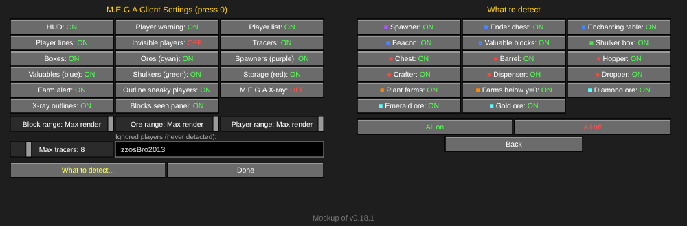

# M.E.G.A Client — Fabric 1.21.11

Client-side ESP, tracers, X-ray, farm alerts and block counter for the server.
**Info only:** it reads what the server already sends your game and draws it on your screen. No automation, no combat aids, no packet tricks.

**[⬇ Download the latest JAR](https://github.com/aresrevision-prog/M.E.G.A/releases/latest)**

*Mockups drawn from the code. The mod builds, but has not been tested in-game yet.*

## Server rules
1. No griefing
2. No spawn camping
3. No TP killing
4. ESPs are allowed **only after the server owner has checked them**. The HUD shows the version (`M.E.G.A v0.18.1`) so the owner can confirm which approved build a player is running.
5. Duping is allowed **only while the server owner is watching**.

## Install
1. Install Fabric Loader for Minecraft 1.21.11.
2. Put **Fabric API** for 1.21.11 and `mega-client-<version>.jar` (not the `-sources` one) in `.minecraft/mods`.
3. Launch the Fabric profile. Press **0** in-game for the settings panel.

Client-side only: nothing is installed on the server, and other players don't need it.

## Colours
| Colour | Shows |
|---|---|
| Purple | Spawners (with the custom M.E.G.A texture) |
| Yellow / black | Other players: striped line, player list, warning banner. Crouching players get a yellow box. Never you or ignored players. |
| Magenta | Invisible players (box only) |
| Green | Shulker boxes |
| Blue | Ender chests, enchanting tables, beacons, and **Valuable blocks** (one button): netherite, ancient debris, diamond / emerald / gold blocks, quartz block / chiseled / pillar / bricks / smooth, deepslate emerald ore, deepslate coal ore, anvils, crafting / smithing tables, grindstones, stonecutters, looms, cartography & fletching tables, furnaces, smokers, blast furnaces |
| Red | Chests, barrels, hoppers, crafters, dispensers, droppers |
| Orange | Farms: built kelp / sugar cane / cactus / bamboo / pumpkin / melon farms (plants next to observers or pistons), and observer/piston machinery below y=0 |
| Cyan | Ores: diamond, emerald, gold (normal + deepslate). No coal, copper, iron, redstone or lapis. |

## Features
- **Player warning** banner when another player is in sight.
- **Player list**: name, distance, direction arrow. Bright yellow = visible, dim yellow = behind cover. No coordinates.
- **Block radar** list: nearest targets with arrow, distance, coordinates and block name (e.g. `RED_SHULKER_BOX`). Double chests count once.
- **Tracers and boxes** through walls to the nearest 8 targets, in their group colour. Striped yellow/black lines to players.
- **Sneaky player outlines**: yellow box round crouching players, magenta box round invisible players.
- **Ore and valuable-block finder** across your whole render distance (setting goes up to 1250 blocks).
- **Farm alert** banner (top centre): nearest built farm, and 32+ moving dropped items. Stone, cobblestone, cobbled deepslate, deepslate and gravel drops are ignored.
- **Blocks seen** panel (top right): how many of each block type are in range.
- **M.E.G.A X-ray**: every other block turns see-through; important blocks keep their real textures; hidden blocks near you keep an outline in their own colour. Client-side night vision keeps things bright.
- **Ignore list**: `IzzosBro2013` (and you) are never detected.
- Scanning is spread over several ticks, nearest chunks first, so there are no lag spikes.

### X-ray: see-through blocks

Outlines show within 12 blocks of you, only where a block touches air. Small shapes like torches, flowers, tall grass, rails and signs stay drawn. Water and lava stay visible.

## Settings panel (press 0)

- Left: on/off buttons, range sliders, max tracers and the ignored-players box.
- **What to detect...**: one on/off button per block type, plus All on / All off.
- Changes save and apply when you press Done or Back.
- Reload config: no key by default; set one in Options → Controls → M.E.G.A Client.

## Spawner texture

Spawners use this design (`src/main/resources/assets/minecraft/textures/block/spawner.png`). Only players with the mod see it.
To change it, open `tools/spawner-editor.html`, paint a new one, and turn the copied `MEGA16:` code into the PNG.

## Config — `config/mega_client.json`
| Key | Default | Notes |
|---|---|---|
| hudEnabled | true | |
| hudX / hudY | 8 / 8 | HUD position |
| maxLines | 8 | rows per list (1–30) |
| blockCountPanel / blockCountLines | true / 15 | Blocks seen panel and its rows |
| playerWarning / playerList | true / true | |
| showInvisiblePlayers | false | list + lines for invisible players (their box always shows) |
| outlineSneaky | true | crouching / invisible player boxes |
| ignoredPlayers | ["IzzosBro2013"] | never detected (case-insensitive) |
| playerRange | 1250 | 1250 = whole render distance |
| spawners / valuables / shulkers / storage / ores | true | group toggles |
| disabledTargets | [] | single block types switched off (set from the panel) |
| maxDistance / oreRange / farmRange | 1250 | search ranges; real limit is your render distance |
| oreBlocks | diamond, deepslate diamond, emerald, gold, deepslate gold | any block IDs |
| valuableBlocks | see Blue above | any block IDs; all share the Valuable blocks button |
| scanIntervalTicks / chunksPerTick | 20 / 24 | scan pacing |
| tracers / boxes / tracePlayers | true | |
| maxTracers / lineWidth | 8 / 2.0 | |
| farmAlert / farmThreshold | true / 32 | alert when more than this many items are moving |
| ignoredItems | stone, cobblestone, cobbled deepslate, deepslate, gravel | never count for the moving-items alert |
| xray | false | M.E.G.A X-ray |
| xrayGhost / xrayGhostRange / xrayGhostMax | true / 12 / 6000 | outlines of hidden blocks |
| xrayEdges / xrayMax | false / 3000 | optional coloured edges round X-ray blocks |

## Build
Every push to `main` builds on GitHub Actions and publishes the JAR to [Releases](https://github.com/aresrevision-prog/M.E.G.A/releases).
Locally: JDK 21, then `./gradlew build` (Windows: `gradlew.bat build`); the JAR is in `build/libs/`.

## Limits
- Only sees chunks your game has loaded; the server never sends anything further away.
- Can't see chest contents until you open them.
- An anti-xray plugin on the server (e.g. Paper's) shows fake ores, so the ore finder and X-ray will be wrong.
- X-ray block hiding doesn't work alongside Sodium (everything else does).
- No combat, movement, teleport or auto-break features: those would break rules 1–3.

More: [`docs/overview.html`](docs/overview.html) has everything on one page.
