# M.E.G.A Client — Fabric 1.21.11

Client-side ESP, tracers, X-ray, farm alerts and block counter for the server.
**Info only:** it reads what the server already sends your game and draws it on your screen. No automation, no combat aids, no packet tricks.

**[⬇ Download the latest JAR](https://github.com/aresrevision-prog/M.E.G.A/releases/latest)**

## Real footage: elytra flight over a 5000-block world
8 stashes buried at random spots within 5000 blocks of spawn in a normal (non-flat) world, flown to one by one with X-ray off then on. Recorded in the real 1.21.11 client by the *Scenario footage* workflow.

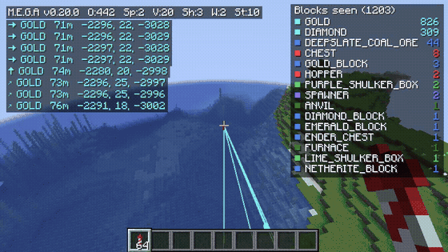

[Full video (32 s, MP4)](docs/video/scenario-flight.mp4)

## Real footage: finding a stash 100 blocks down, digging to it, placing a banner
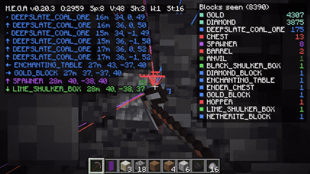

[Full video (15 s, MP4)](docs/video/dig-to-stash.mp4)

## Real in-game screenshots (Minecraft 1.21.11)
Taken automatically on every build by the in-game test, which launches the real 1.21.11 client with the mod, builds a test world and checks that everything works. A release is only published if it passes.

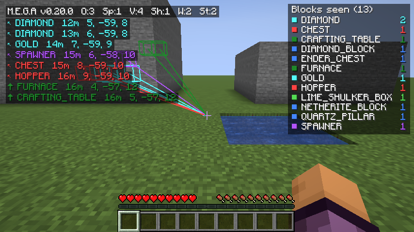
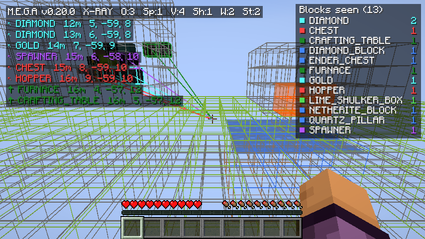
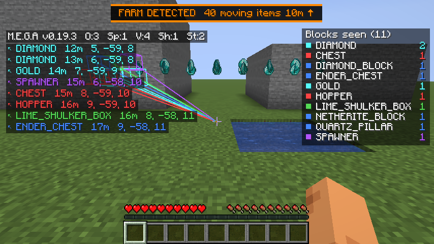
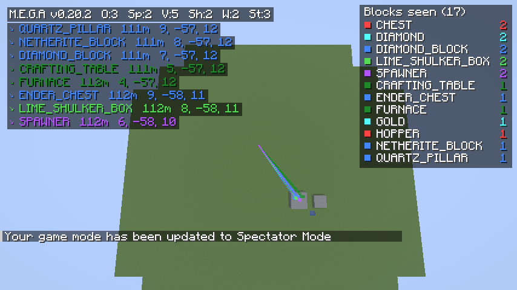
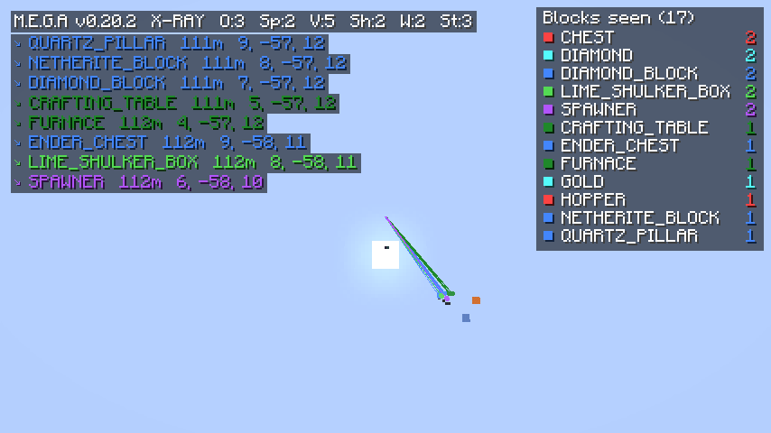
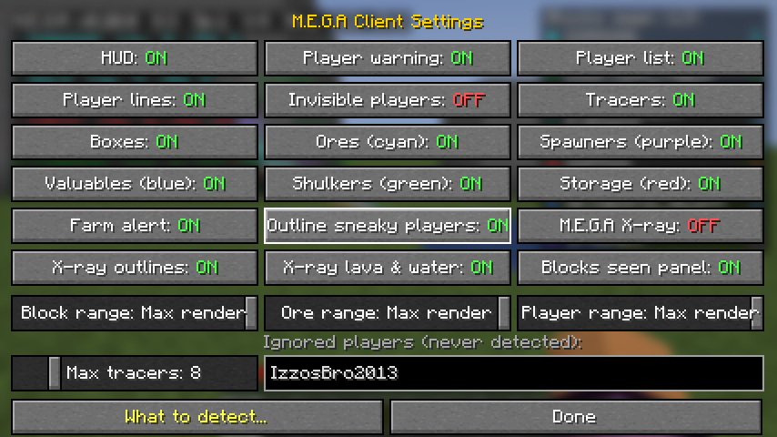
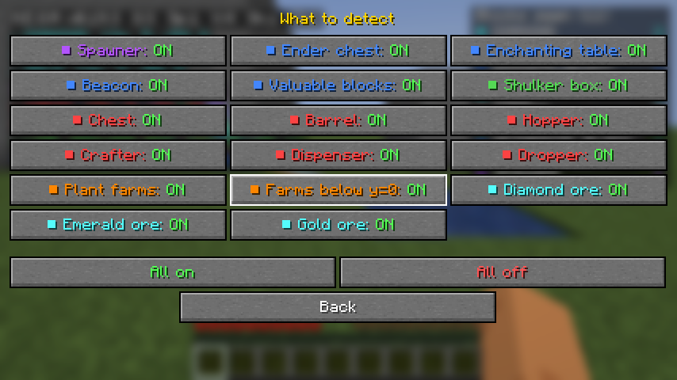

## Mockups
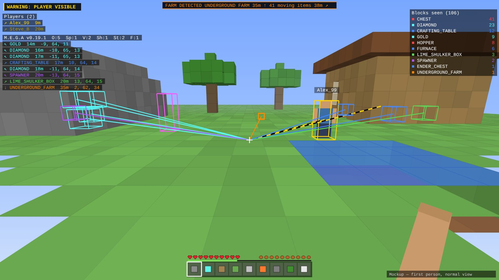
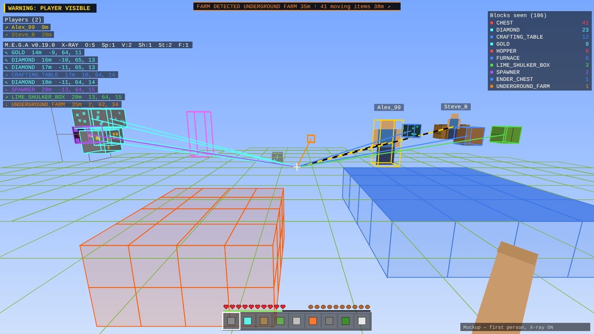

**Elytra flight over a buried stash:**

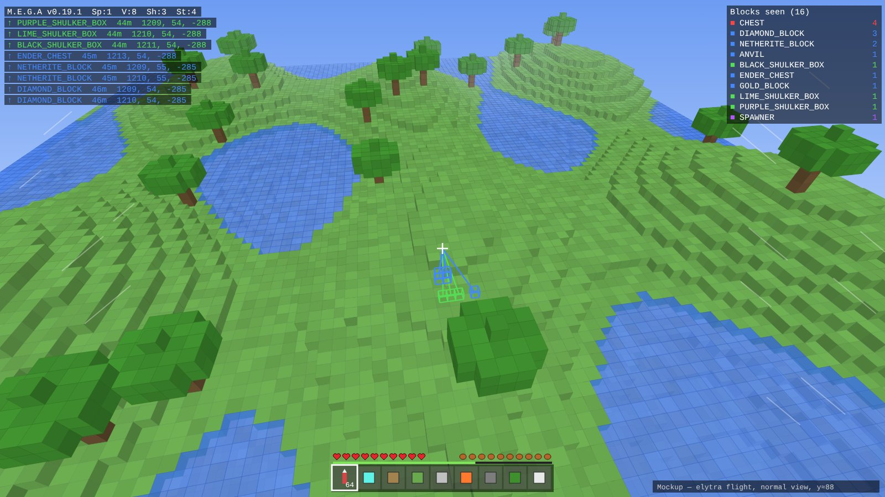
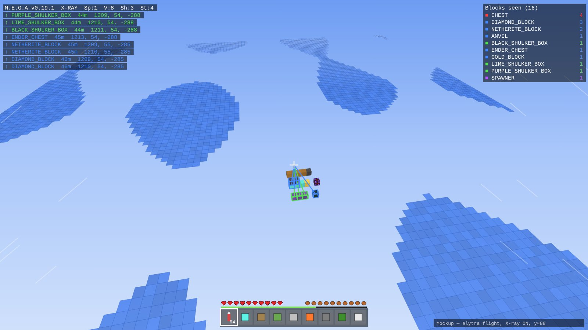

*Mockups drawn from the code. See the real screenshots above for the actual look.*

## Server rules
1. No griefing
2. No spawn camping
3. No TP killing
4. ESPs are allowed **only after the server owner has checked them**. The HUD shows the version (`M.E.G.A v0.30.0`) so the owner can confirm which approved build a player is running.
5. Duping is allowed **only while the server owner is watching**.
6. Teleporting is allowed (M.E.G.A itself has no teleport: it can't be done client-side without cheating).

## Install (Windows, automatic)
1. Download **[Install-MEGA.bat](https://github.com/aresrevision-prog/M.E.G.A/releases/latest/download/Install-MEGA.bat)** and double-click it. If Windows shows "Windows protected your PC", click **More info → Run anyway**.
2. It installs Fabric Loader for 1.21.11, adds a **M.E.G.A** profile to the Minecraft Launcher, gives the profile its own game folder (`.minecraft\mega-1.21.11`, so mods for other Minecraft versions never clash) with the newest mod in it, copies your settings and server list, and can add the spawner texture pack. No Java or Fabric API needed.
3. Open the Minecraft Launcher, pick the **M.E.G.A** profile next to Play, and press Play. In game press **0** for the settings panel.

Run it again any time to update. Your other launcher profiles are kept (a backup is saved as `launcher_profiles.json.mega-backup`). The installer is tested on a clean Windows machine on every build.

## Install (manual)
1. Install Fabric Loader for Minecraft 1.21.11 ([fabricmc.net](https://fabricmc.net/use/installer/)).
2. Put `mega-client-<version>.jar` (not the `-sources` one) in `.minecraft/mods`. **Fabric API is not needed.**
3. Launch the Fabric profile. Press **0** in-game for the settings panel.

Client-side only: nothing is installed on the server, and other players don't need it. The mod needs a mod loader to run at all (Minecraft has no built-in way to load mods); Fabric Loader is the only thing it depends on.

## Colours
| Colour | Shows |
|---|---|
| Purple | Spawners |
| Yellow / black | Other players: striped line, player list, warning banner. Crouching players get a yellow box. Never you or ignored players. |
| Magenta | Invisible players (box only) |
| Green | Shulker boxes |
| Blue | Ender chests, enchanting tables, beacons, and **Valuable blocks** (one button): netherite, ancient debris, diamond / emerald / gold blocks, quartz block / chiseled / pillar / bricks / smooth, deepslate emerald ore, deepslate coal ore |
| Dark green | **Workstations** (one button): anvils, crafting / smithing tables, grindstones, stonecutters, looms, cartography & fletching tables, furnaces, smokers, blast furnaces |
| Red | Chests, barrels, hoppers, crafters, dispensers, droppers |
| Orange | Farms: built kelp / sugar cane / cactus / bamboo / pumpkin / melon farms (2+ observers or pistons aimed at the plants; named after the plant most of them aim at), and observer/piston machinery below y=0 |
| Pale yellow | **Lights** (underground): torches, lanterns, glowstone, sea lanterns, froglights, campfires... only when buried 4+ blocks under the surface (caves never have them). One entry per area, e.g. `LIGHTS_UNDERGROUND x9` |
| White | **built_block**: every block that never generates naturally (concrete, concrete powder, glazed terracotta, wool, carpet, all glass and panes, polished stone, smooth stone). One entry per area with 6+, e.g. `BUILT_BLOCKS x40`. Switch any block type off on its edit page |
| Pink | **Base signs**: trading halls (6+ villagers packed together), animal pens (12+ of one animal), tamed pets, named mobs. Each can be switched off |
| Cyan | Ores: diamond, emerald, gold (normal + deepslate). No coal, copper, iron, redstone or lapis. |

## Features
- **Player warning** banner when another player is in sight.
- **Player list**: name, distance, direction arrow. Bright yellow = visible, dim yellow = behind cover. No coordinates.
- **Block radar** list: nearest targets with arrow, distance, coordinates and block name (e.g. `RED_SHULKER_BOX`). Double chests count once.
- **Tracers and boxes** through walls to the nearest 8 targets, in their group colour. Striped yellow/black lines to players.
- **Sneaky player outlines**: yellow box round crouching players, magenta box round invisible players.
- **Ore and valuable-block finder** across your whole render distance (setting goes up to 1250 blocks).
- **Farm alert** banner (top centre): nearest built farm, and 32+ moving dropped items. Stone, cobblestone, cobbled deepslate, deepslate and gravel drops are ignored.
- **Blocks seen** panel (top right): how many of each block type are in range.
- **M.E.G.A X-ray**: every other block turns see-through; important blocks keep their real textures; hidden blocks near you keep an outline in their own colour. Client-side night vision keeps things bright.
- **Ignore list**: `IzzosBro2013` (and you) are never detected.
- Scanning is spread over several ticks, nearest chunks first, so there are no lag spikes.

### X-ray: see-through blocks
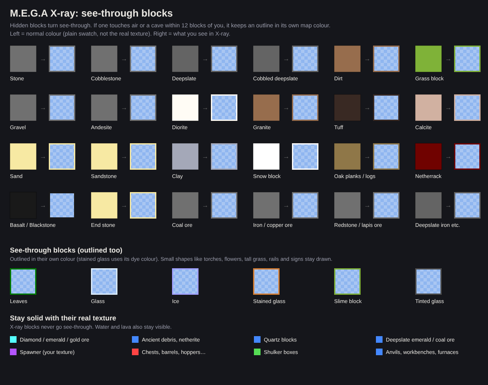

Outlines show within 12 blocks of you, only on the sides of a block that touch air (ground seen from above is just its top square, no vertical lines). They're drawn thicker, and blocks X-ray keeps (ores, stash blocks, bedrock) hide the outlines behind them, so nothing shows through a solid block. **Bedrock stays visible** so you can see the bottom of the world. Small shapes like torches, flowers, tall grass, rails and signs stay drawn.

**Lava and water** (panel button: *X-ray lava & water*): within 12 blocks, lava hidden inside rock shows as **see-through orange** with orange edges, so you can see the whole pool. Water keeps its normal texture, with blue edges.

## Shulker contents
Placed shulker boxes: the server never sends what's inside, so no mod can see it. But shulker **items** carry their contents:
- **Dropped, in item frames, or held by a player**: listed and lined in green with what's inside, e.g. `DROPPED_SHULKER: 128 Block of Diamond +1 more`, or `EMPTY`.
- **In any chest or inventory you open**: hover a shulker for its full contents (the game only lists 5) plus `M.E.G.A: 3/27 slots used, 133 items`.

Config: `shulkerPeek` (tooltip on/off).

## Radars (bottom right)
Three radars: **SKY** (10+ blocks above the ground under it: elytra players, phantoms), **GROUND**, and **BELOW 0** (under y=0: deep bases, caves). They turn with you (up = where you're facing). Yellow = players, red = hostile mobs, green = animals, grey = minecarts/boats. Distances are square-root scaled so nearby things spread out. Range up to 1250 (default 1000), but the server only sends entities that are fairly close (players within your view distance, mobs ~100 blocks), so that's the real limit. On/off and range: panel → Display.

## Deep scan (G)
Press **G** to show only stashes **buried underground** (at least 4 blocks under the surface above them). It rescans straight away; surface builds (houses, bases) drop out of the list and lines, and the HUD shows `DEEP`. Press G again for everything. (T is chat in Minecraft, so it's on G; change it in Controls → Key Binds → Miscellaneous.)

It can only see chunks the server has sent you: no client mod can make the server load more.

## Waypoints and deaths
- Press **B** to drop a waypoint where you stand. Your last 3 deaths are saved automatically (☠, red).
- Each one shows as a tall beam and a box in the world, and in a **Waypoints** list on the HUD (nearest 5, with arrow and distance). With lines on, a line points to it too.
- Panel (press 0) → **Waypoints** tab: click one to select it, then Rename / Hide / X to delete; Add here; Show waypoints on/off.
- Saved per server and per world in `config/mega_waypoints.json`.

## Settings panel (press 0)
Four tabs (Colours, Display, Players, Waypoints):
- **Colours & blocks**: each colour has an ON/OFF button and **Edit blocks**. The edit page lists that colour's blocks: click one to turn it on/off, **X** removes it, type a block name (e.g. `obsidian`) and press **Add** to add any block. Matches show as you type. Adding a block that's in another colour moves it. **Reset** puts the default blocks back. The Farms page edits the plants that count as a farm.
- **Display**: HUD, Blocks seen panel, tracer lines, boxes, X-ray options, max lines, list rows, ranges.
- **Players**: warning, list, lines, invisible players, sneaky outlines, range, ignored players.

Every colour that's ON and found always gets at least one line and one list row (the nearest of each colour comes first), so a pile of chests can't push spawners or shulkers off the screen. Dark colours are lightened on the HUD so the text stays readable.

Changes save and apply when you press Done or Back. Press **R** to refresh: reloads the settings file and rescans everything straight away. Both keys can be changed in Options → Controls → Key Binds → Miscellaneous.

## Spawner texture (optional resource pack)
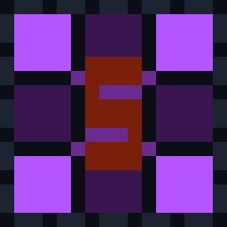

The mod uses Minecraft's normal spawner texture. The M.E.G.A design is a separate resource pack: [`resourcepacks/MEGA-Spawner-Texture.zip`](resourcepacks/MEGA-Spawner-Texture.zip).
Put the zip in `.minecraft/resourcepacks` (Windows: `%appdata%\.minecraft\resourcepacks`), then Options → Resource Packs → move it to the right. Works with or without the mod.

## Config — `config/mega_client.json`
| Key | Default | Notes |
|---|---|---|
| hudEnabled | true | |
| hudX / hudY | 8 / 8 | HUD position |
| maxLines | 8 | rows per list (1–30) |
| blockCountPanel / blockCountLines | true / 15 | Blocks seen panel and its rows |
| playerWarning / playerList | true / true | |
| showInvisiblePlayers | false | list + lines for invisible players (their box always shows) |
| outlineSneaky | true | crouching / invisible player boxes |
| ignoredPlayers | ["IzzosBro2013"] | never detected (case-insensitive) |
| playerRange | 1250 | 1250 = whole render distance |
| spawners / valuables / shulkers / storage / ores / workstations | true | colour on/off |
| spawnerBlocks / shulkerBlocks / storageBlocks / valuableBlocks / workstationBlocks / oreBlocks | see Colours | each colour's block list (edit in the panel) |
| farmPlants | kelp, sugar cane, cactus, bamboo, pumpkin, melon | plants that count as a farm |
| disabledTargets | [] | single blocks switched off, e.g. `minecraft:hopper` (set from the panel) |
| maxDistance / oreRange / farmRange | 1250 | search ranges; real limit is your render distance |
| oreBlocks | diamond, deepslate diamond, emerald, gold, deepslate gold | any block IDs |
| scanIntervalTicks / chunksPerTick | 20 / 24 | scan pacing |
| tracers / boxes / tracePlayers | true | |
| maxTracers / lineWidth | 8 / 2.0 | |
| oresLast | true | list, lines and Blocks seen show placed stash blocks before natural ores (any colour, e.g. deepslate coal) |
| farmAlert / farmThreshold | true / 32 | alert when more than this many items are moving |
| ignoredItems | stone, cobblestone, cobbled deepslate, deepslate, gravel | never count for the moving-items alert |
| xray | false | M.E.G.A X-ray |
| xrayGhost / xrayGhostRange / xrayGhostMax | true / 12 / 6000 | outlines of hidden blocks |
| xrayFluids | true | see-through lava and water edges in X-ray |
| xrayEdges / xrayMax | false / 3000 | optional coloured edges round X-ray blocks |

## Build
Every push to `main` builds on GitHub Actions and publishes the JAR to [Releases](https://github.com/aresrevision-prog/M.E.G.A/releases).
Locally: JDK 21, then `./gradlew build` (Windows: `gradlew.bat build`); the JAR is in `build/libs/`.

## Limits
- Only sees chunks your game has loaded; the server never sends anything further away.
- Can't see chest contents until you open them.
- An anti-xray plugin on the server (e.g. Paper's) shows fake ores, so the ore finder and X-ray will be wrong.
- X-ray block hiding doesn't work alongside Sodium (everything else does).
- No combat, movement, teleport or auto-break features: those would break rules 1–3.

More: [`docs/overview.html`](docs/overview.html) has everything on one page.
